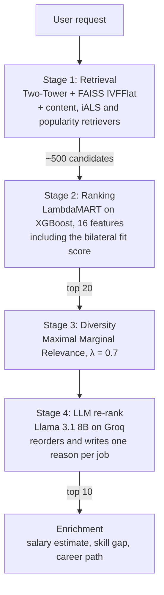

# NexusHire: Hybrid Job Recommendation System

NexusHire recommends jobs to candidates through a multi-stage cascade. Cheap retrievers narrow the catalogue, a learning-to-rank model orders the shortlist, a diversity pass removes near-duplicates, and an LLM re-ranker picks the final ten and explains each pick. The system also models the employer's side of every match, so a recommendation is scored by whether the candidate would want the job *and* whether the recruiter would shortlist the candidate.

It was built as the term project for the Recommender Systems course at FAST NUCES, Karachi.

> **Where the code lives:** the full source is on the [`dev`](../../tree/dev) branch. `main` holds this README.

## Pipeline



Each stage spends more compute per item than the one before it, and sees fewer items. Only retrieval touches the whole catalogue, which is why it uses the cheapest models. If the Groq call fails or no key is set, the pipeline returns the ranker's order and users still get results.

## What is inside

### Retrieval
| Component | File | Notes |
|---|---|---|
| Two-Tower network | `src/models/two_tower.py` | PyTorch, 128-d shared space, in-batch softmax, hidden layers 512 → 256 |
| FAISS index | `src/retrieval/faiss_index.py` | IVFFlat, `nlist=100`, `nprobe=10` |
| Content-based | `src/models/content_based.py` | TF-IDF (5,000 features) plus `all-MiniLM-L6-v2` sentence embeddings |
| Collaborative filtering | `src/models/collaborative.py` | Implicit ALS on implicit feedback, confidence `alpha=40` (Hu, Koren and Volinsky, 2008) |
| Popularity | `src/models/popularity.py` | Recency decay with a 30-day half-life, fallback for users with no history |
| Hybrid combiner | `src/models/hybrid.py` | Blend weights change for warm, lukewarm and cold users |

### Ranking
`src/models/ltr_ranker.py` trains XGBoost with `rank:pairwise` (LambdaMART). Each positive is paired with 50 random negatives and 5 hard negatives from the same category. The 16 features are listed in `src/features/ranking_features.py`:

```
two_tower_score   content_score   collab_score     popularity_score
skill_overlap     skill_jaccard   location_match   experience_match
salary_alignment  days_since_posted  user_hist_apply_rate_in_category
s_user_to_job     s_job_to_user   bilateral_score  hybrid_score   bert4rec_score
```

### Reciprocal scoring
`src/models/reciprocal.py` trains a second tower on the flipped interaction graph, so it scores how likely a recruiter for a job is to shortlist a given candidate. The bilateral score is `σ(s_user→job) × σ(s_job→user)`, and it is fed to the ranker as a feature.

### Sequence and user modelling
- **BERT4Rec** (`src/models/bert4rec.py`): a bidirectional transformer trained with masked-item prediction over each user's interaction sequence. Its score is one ranking feature.
- **Dual user profile** (`src/features/user_profile.py`): a long-term vector over all history and a short-term vector over recent interactions. Cold users get both slots from their resume text.

### Re-ranking
`src/models/llm_reranker.py` sends the top 20 and a short profile summary to `llama-3.1-8b-instant` on Groq. The prompt includes the scores from earlier stages, so the one-sentence reasons stay tied to them. Up to three Groq keys are rotated when one hits a rate limit.

### Domain layer
| Module | What it does |
|---|---|
| `src/nlp/resume_ner.py` | Pulls skills, titles, education and years of experience from resume text (regex plus optional spaCy) |
| `src/ontology/skill_ontology.py` | ESCO-inspired skill graph with alias normalisation (`js` → `javascript`) and relatedness |
| `src/nlp/query_understanding.py` | Turns a free-text search into structured filters |
| `src/models/salary_predictor.py` | Gradient-boosted salary regressor trained on real UK salary labels |
| `src/models/skill_gap.py` | Missing skills per job, weighted by ontology distance |
| `src/models/career_path.py` | Likely next titles from apply sequences |

## Data

| Source | Used for |
|---|---|
| LinkedIn job postings (`postings.csv`) | Job catalogue and training |
| Kaggle resume dataset (`Resume.csv`, about 2,500 resumes) | Users and cold-start evaluation |
| Kaggle `Train_rev1.csv` (about 240,000 UK jobs with salaries) | Salary regressor |

`src/data/real_data_adapter.py` maps these into three canonical files (`jobs.csv`, `users.csv`, `interactions.csv`). Interactions are weighted by intent: view = 1, save = 3, apply = 5. A synthetic generator in `src/data/acquire.py` is kept for tests and local runs without the datasets.

## Evaluation

`src/evaluation/metrics.py` reports six families of metrics at K = 5, 10 and 20:

| Metric | Measures |
|---|---|
| Precision@K, Recall@K | Hit rate and coverage of held-out items |
| NDCG@K | Ranking quality, weighted by position |
| MAP | Precision averaged over all relevant items |
| Catalogue coverage | Share of the catalogue that ever gets recommended |
| Intra-list diversity | Average dissimilarity inside one list |
| `bilateral_coverage`, `balanced_ranking_ratio`, `two_sided_ndcg` | Whether a match suits the employer as well as the candidate |

Each user's history is split 80/20 so that every test user has items in both halves. Results are broken down by activity bucket to show how quality falls off for cold users. The split is suitable for offline ranking metrics. An online experiment would need a time-based split, and all ranking claims here are offline results.

## Getting started

```bash
git clone -b dev https://github.com/Mehdi-Abidi/Hybrid_Job_Recommendation_System.git
cd Hybrid_Job_Recommendation_System
python -m venv venv
venv\Scripts\activate          # Windows
# source venv/bin/activate     # macOS / Linux
pip install -r requirements.txt
```

Create a `.env` file in the project root:

```bash
GROQ_API_KEY=your_key          # optional, enables the LLM re-ranker
GROQ_API_KEY_2=                # optional extra keys for rotation
GROQ_API_KEY_3=
KAGGLE_USERNAME=your_username  # needed to download the datasets
KAGGLE_KEY=your_key
```

Place `postings.csv`, `Resume.csv` and `Train_rev1.csv` in `data/raw/`. Settings live in `config/config.yaml`.

### Train and evaluate

```bash
python -m src.models.train                     # every model, then offline evaluation
python -m src.models.train --no-tier2          # skip BERT4Rec for a faster run
python -m src.models.train --eval-with-llm     # also evaluate the LLM cascade on 200 sampled users
python -m src.models.train --checkpoint-dir /content/drive/MyDrive/nexushire   # save each model as it finishes (Colab)
```

Artifacts are written to `models_artifacts/`. Runs are logged to MLflow when it is installed. Set `MLFLOW_DISABLE=1` to turn logging off.

### Serve

```bash
uvicorn api.main:app --reload             # API on http://localhost:8000, docs at /docs
streamlit run app/streamlit_app.py        # Streamlit demo
cd frontend && npm install && npm run dev # Next.js frontend on http://localhost:3000
```

| Endpoint | Purpose |
|---|---|
| `GET /recommend/multi-stage/{user_id}` | Full cascade with explanations |
| `GET /recommend/{user_id}` | Classical recommenders (`hybrid`, `content`, `collab`, `popularity`) |
| `POST /recommend/new-user` | Cold start from resume text and skills |
| `GET /pipeline/inspect/{user_id}` | Candidates and scores at every stage |
| `GET /explain/{user_id}/{job_id}` | Signal-level explanation for one job |
| `GET /similar-jobs/{job_id}` | Job-to-job neighbours |
| `POST /query/parse` | Free text to structured filters |
| `POST /salary/predict` | Salary range estimate |
| `POST /skill-gap` | Missing skills with nearby alternatives |
| `GET /health` | Liveness check |

The Streamlit app has four tabs: Job Seeker, Recruiter, Pipeline Inspector and Tools. The Next.js frontend (Next.js 16, React 19, Tailwind CSS 4, GSAP and Zustand) reads `NEXT_PUBLIC_API_URL` and defaults to `http://localhost:8000`.

### Tests

```bash
pytest tests/ -v
```

The suite has 78 tests. They cover preprocessing, the time split, user profiles, iALS, LTR negative sampling, Two-Tower features, MMR, reciprocal scoring, evaluation metrics, the domain modules and API routing. A deterministic smoke fixture in `tests/fixtures/build_smoke.py` lets them run without the real datasets.

## Repository layout

```
api/            FastAPI app and Pydantic schemas
app/            Streamlit demo
config/         config.yaml and the typed settings loader
frontend/       Next.js frontend
src/
  data/         dataset adapters, preprocessing, synthetic generator
  features/     text, structured and ranking features, user profiles
  models/       every recommender and the training orchestrator
  retrieval/    FAISS wrapper
  pipeline/     multi-stage cascade with MMR
  evaluation/   metrics and evaluator
  nlp/          resume NER and query understanding
  ontology/     skill ontology
  utils/        device selection, logging, MLflow tracking
tests/          pytest suite and smoke fixtures
```

## Design notes

- **Why a cascade.** Retrieval is tuned for recall and ranking for precision. Splitting them lets each stage use the model it can afford, and every stage can be tested and inspected on its own.
- **Why two towers.** Job vectors are computed once. Each request only encodes the user and runs a nearest-neighbour search. A new user with only a resume still gets a usable vector, which an ID-based factorisation cannot give.
- **Why reciprocal scoring.** In our ablation, removing the reciprocal signal raised Precision@5 by about one point and cut bilateral coverage by twelve. A candidate-only evaluation would have counted that as an improvement.
- **Why the LLM sees only 20 items.** It caps cost and latency. Ordering and explanation come from the same call, so they cannot disagree.

## Team

- **Syed Muhammad Mehdi Abidi**
- **Ammar Shah**
- **Syed Mufeed Haider**

FAST NUCES, Karachi, Pakistan.
